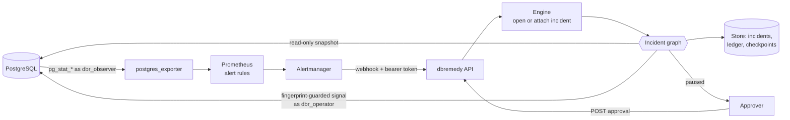
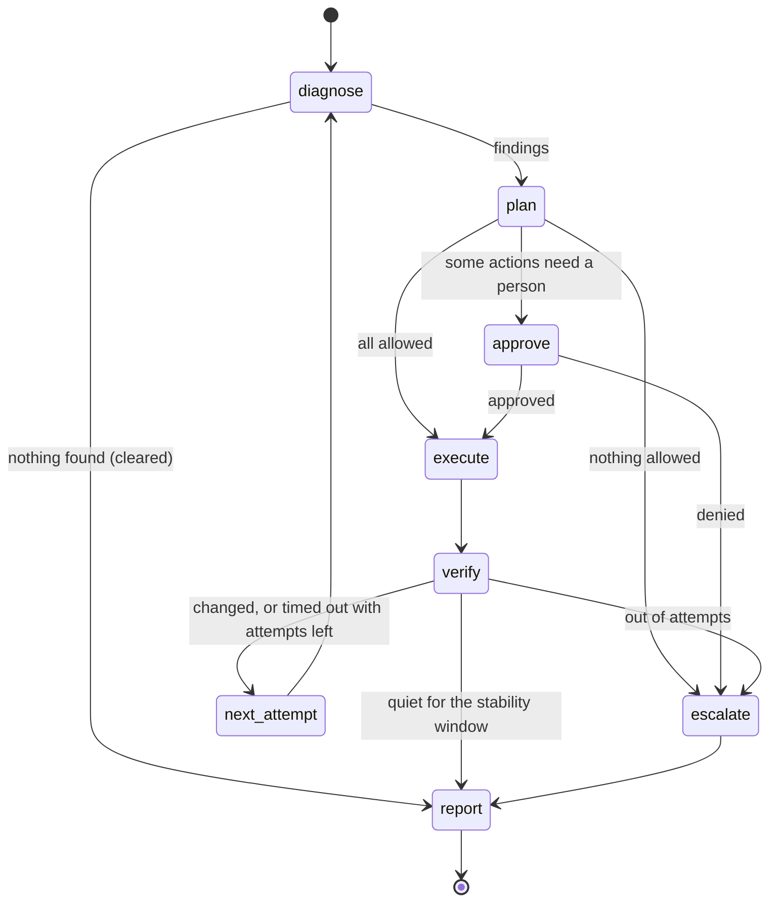

# Architecture

## The incident graph

| Node | Does | Writes |
|---|---|---|
| diagnose | Takes a snapshot as the observer and runs the runbook's detector with its parameters | timeline event with the findings |
| plan | Asks the planner for proposals; the governor reviews them with the ledger as history | refused proposals in the ledger; plan event |
| approve | `interrupt()` with the exact actions; resumes with the decision | approval event; rejected actions in the ledger |
| execute | Runs each allowed action once (the ledger id is derived from incident, finding and action) | ledger row with the result |
| verify | Polls the detector until it stays quiet for `stable_s`, or another step becomes applicable, or the timeout | verify event |
| escalate | Records why and to whom | escalation event |
| report | Closes the incident, computes time to close, writes the Markdown report | incident status, outcome, report |

LangGraph re-runs a node from its start when it resumes (after an approval or a restart). Every
node that writes checks the ledger first, so re-running is safe.

## Snapshots and detectors

A snapshot is three read-only queries: `pg_stat_activity` joined with `pg_roles` (with
`pg_blocking_pids()` for each session), `pg_stat_user_tables` joined with `pg_class` for sizes,
and a few settings. The observer connection sets `default_transaction_read_only`, a 5-second
statement timeout and a 1-second lock timeout.

Detectors are pure functions from a snapshot and parameters to findings. A finding carries the
attributes conditions are evaluated on (state, application, ages, blocked count, dead tuple
ratio, size), the target (a session fingerprint or a table) and evidence for the report.
Detectors report sessions the agent must not touch, so those incidents escalate rather than
disappear.

The lock detector follows `pg_blocking_pids()` edges from each long-waiting session to the
sessions that are not themselves waiting on a lock: those are the roots. Waiters are victims and
are never targets.

## Planning and governing

Planners return proposals: a finding id, an action name and a reason. The rule planner takes the
first runbook step whose conditions hold. The model planner sends the steps and findings to an
OpenAI-compatible endpoint with a function whose schema enumerates only this incident's finding
ids and this runbook's actions. The rogue planner exists to test the governor.

The governor checks, in order: the action is in the catalog; the runbook uses it; the target is
a current finding of the right kind; the session is not protected (superuser, background worker,
the agent's own roles, protected users and applications); it was not already applied; a step's
conditions hold (including `after:` conditions, which read the ledger); the runbook's and the
policy's caps. Then it upgrades `allow` to `approval` for steps that require it, change freezes,
and incidents that would end more sessions without a person than the batch threshold.

## Execution

`pg_cancel_backend()` and `pg_terminate_backend()` are called from a single `SELECT ... FROM
pg_stat_activity WHERE pid = ... AND backend_start = ... AND xact_start IS NOT DISTINCT FROM ...
AND query_start IS NOT DISTINCT FROM ...`. If the row is gone, nothing is signalled and the
result is `stale`. `VACUUM (ANALYZE)` runs with identifiers quoted by psycopg and a lock timeout.

## Storage

| Store | Incidents and ledger | Checkpoints |
|---|---|---|
| memory | SQLite in memory | `InMemorySaver` |
| sqlite | SQLite file (WAL) | `SqliteSaver` |
| postgres | PostgreSQL tables `dbr_*` | `PostgresSaver` |

An incident's `open_key` column is unique while it is open, so concurrent deliveries of the same
alert attach to one incident. It is cleared on close, so the next occurrence opens a new one.

## Deployment

The agent is one process. It needs network access to the target database (as two roles), to
Alertmanager's caller, and to its store. [docker-compose.yml](../docker-compose.yml) runs the
whole pipeline; the container image runs as UID 10001 with a SQLite store on a volume by
default.
